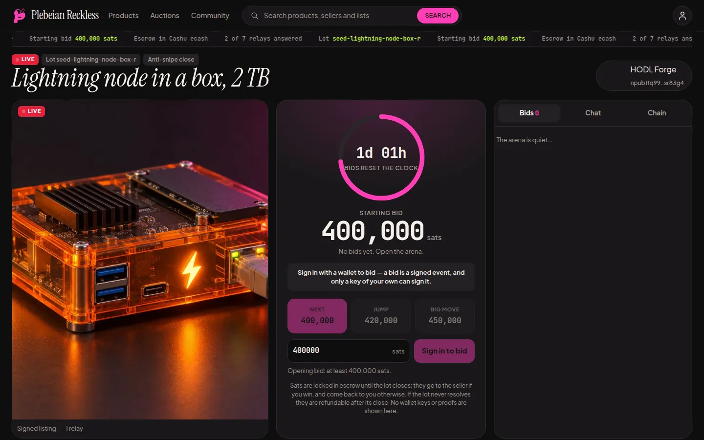
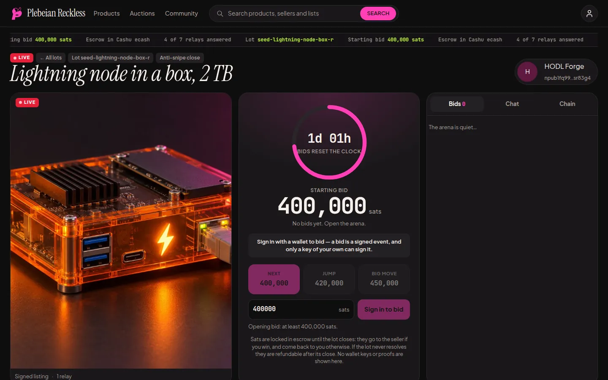
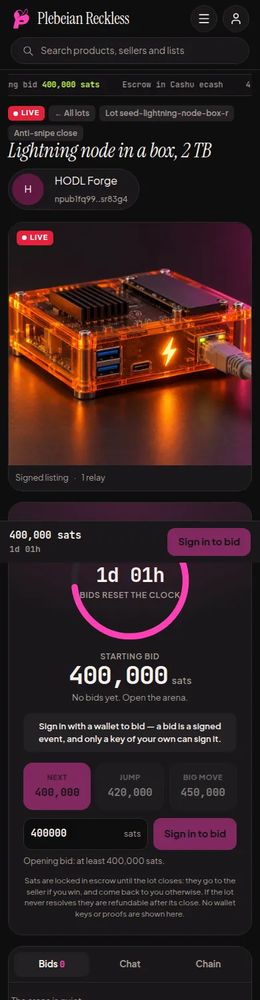

# Auctions

Auctions on Reckless use test sats from the Reckless Cashu mint, so bid freely.

## The auctions page

Open **Auctions** from the top bar. The ticker along the top shows what's happening right now. **On the block** is the featured lot, and you can sort the rest by newest, ending soonest or highest bid.

## A lot page

Every lot has three columns:

- **Gallery.** Photos of the item, plus a LIVE or ENDED badge.
- **Bid panel.** The countdown ring, the current or starting bid and the bid buttons.
- **Bids, Chat and Chain.** Every bid as it arrives, a chat for the lot and the Nostr events behind it.

## Placing a bid

1. Sign in, and make sure your [wallet](wallet.md) has some ecash.
2. Tap **Next**, **Jump** or **Big move** to fill in an amount, or type your own.
3. Click **Bid**. Your wallet signs the bid and locks the sats in escrow.

If you win, the sats go to the seller. If you're outbid, or the lot doesn't settle, they come back to you. Some lots have anti-snipe, which means a late bid adds time to the clock.

On a phone, the columns stack so the bid panel is right under the photo.

## Running your own auction

Sellers can create auctions from **Create auction** on the auctions page, or from **Dashboard → Auctions**. See [Selling](selling.md).

Next up: [Wallet](wallet.md).
