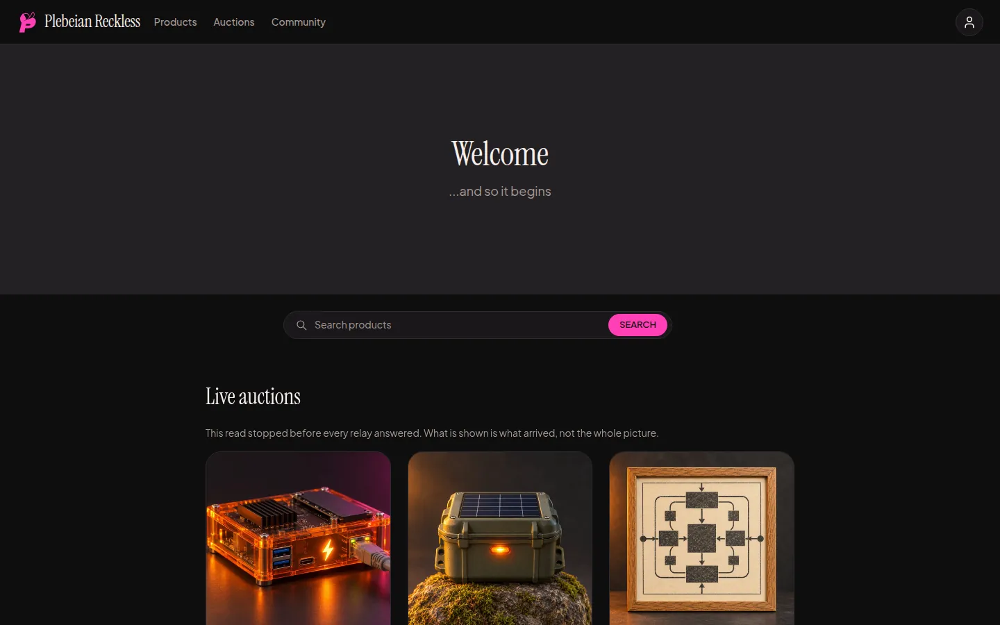
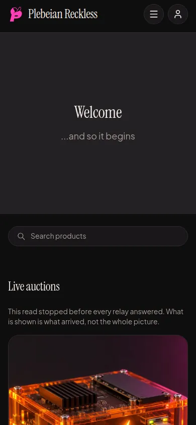
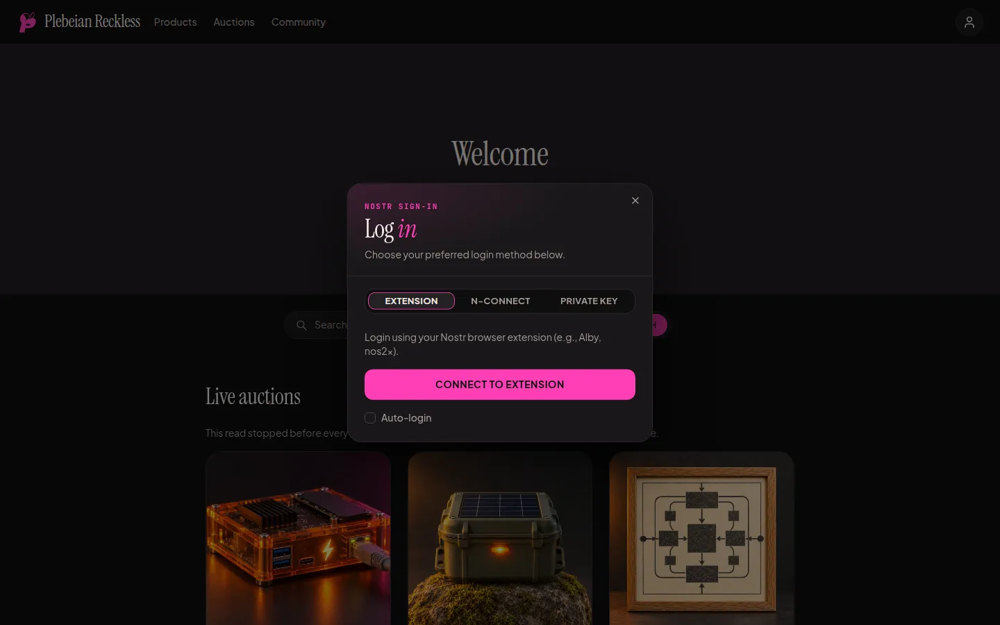
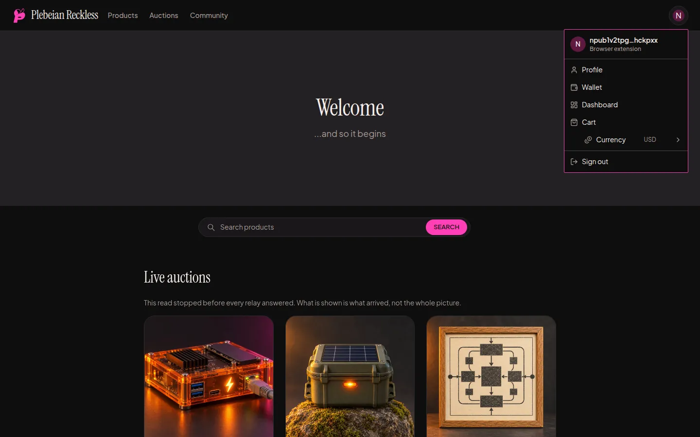
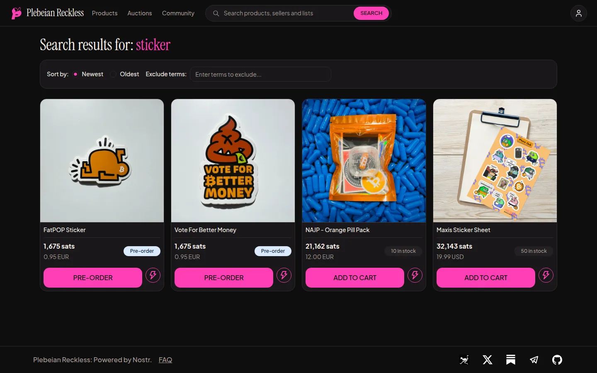

# Getting started

You can browse Reckless without signing in. You'll need to sign in to buy, bid, sell or use the wallet.

## The home page

The home page is where it all starts: a welcome banner, a search bar and the live auctions. The links at the top take you to Products, Auctions and Community.

On a phone, the links fold into the menu button at the top right, next to the account button.

## Signing in

Click the person icon at the top right, then **Sign in**. Pick whichever method suits you:

- **Extension.** Use a Nostr browser extension such as Alby or nos2x. This is the easiest option on a desktop.
- **N-Connect.** Connect a remote signer, such as a signer app on your phone, by QR code or bunker link.
- **Private Key.** Paste or create a key directly. This is handy for quick tests, but please keep real keys in a signer.

Tick **Auto-login** if you'd like to stay signed in on this device.

## The account menu

Once you're signed in, the person icon turns into your avatar. Click it to open your profile, wallet, dashboard and cart, to switch the display currency, or to sign out.

## Search

Type into the search bar and press **Search**. Results show products, and you can sort them or exclude words to narrow things down.

Next up: [Shopping](shopping.md).
