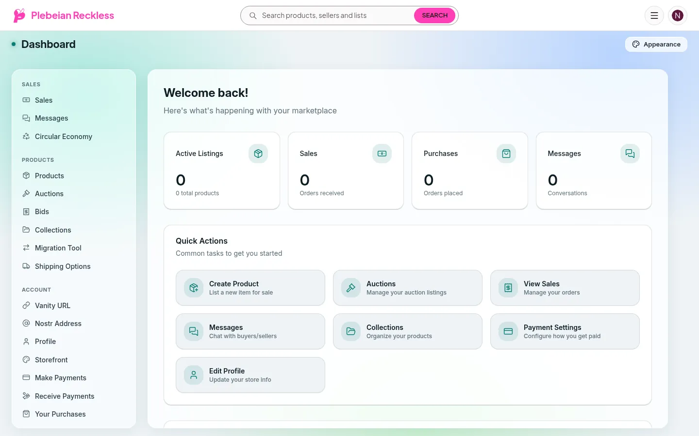
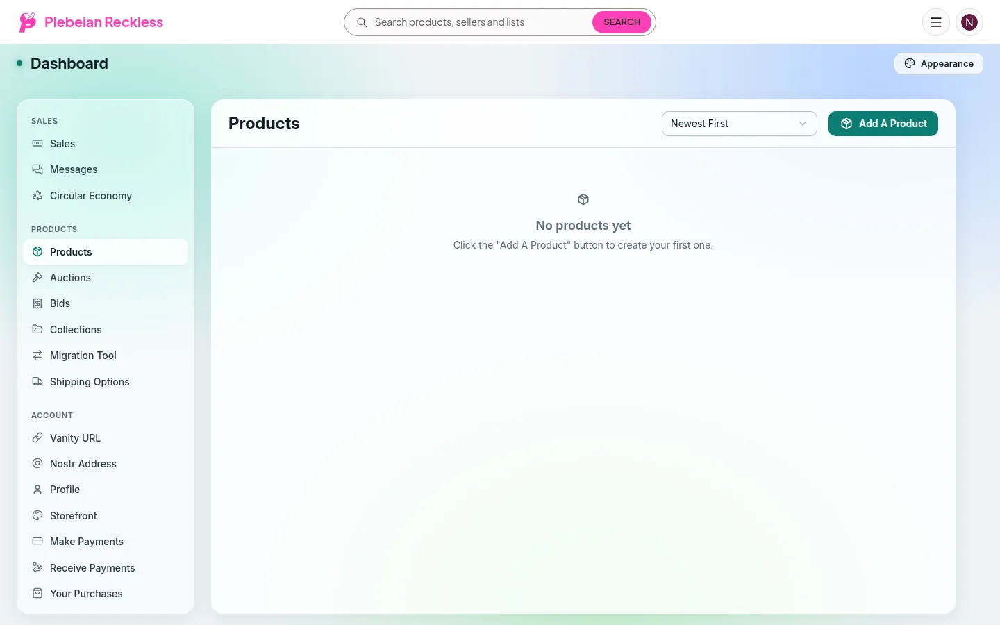
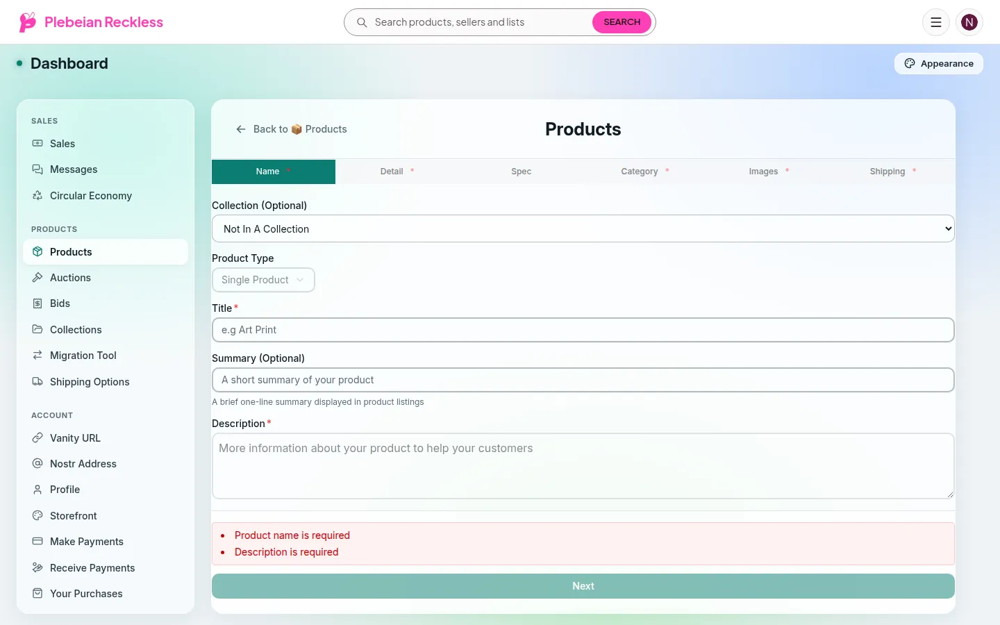
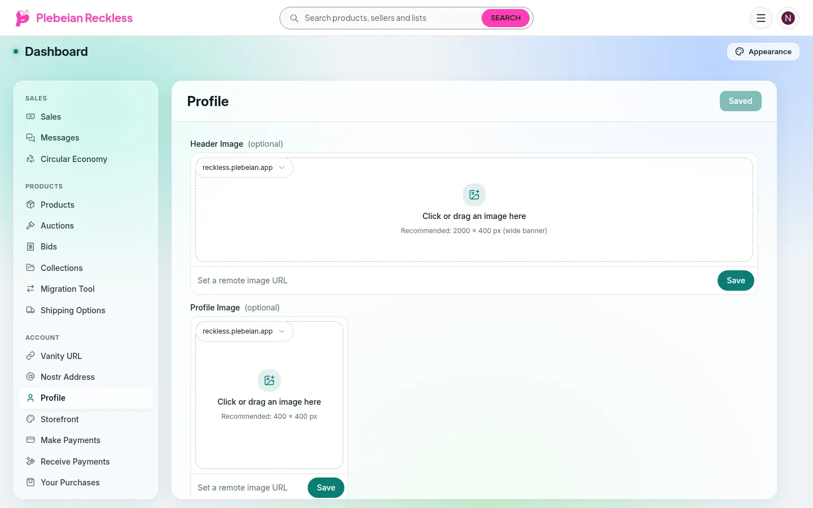
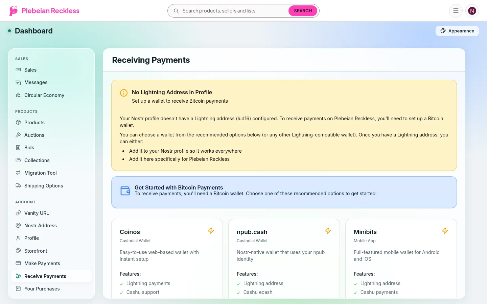
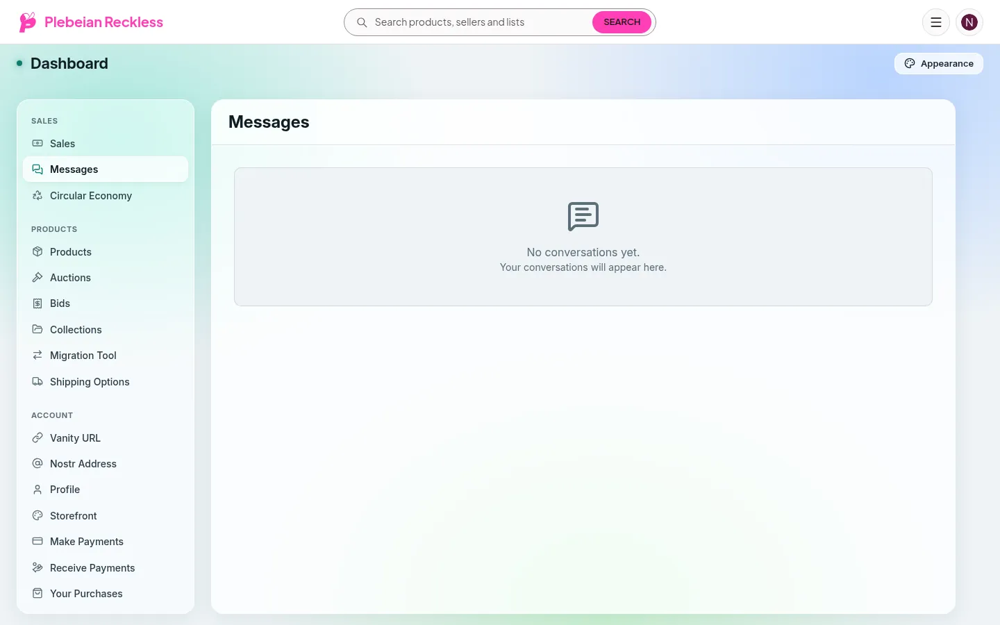

# Selling

Everything for sellers lives in the dashboard. Open it from the account menu, under **Dashboard**.

## The dashboard

The home screen shows your listings, sales, purchases and messages at a glance, with quick actions for the common jobs. The sidebar is grouped into Sales, Products and Account.

## Listing a product

1. Go to **Products** and click **Add A Product**.
2. Work through the tabs: **Name**, **Detail**, **Spec**, **Category**, **Images** and **Shipping**. Tabs with a star still need something from you.
3. Click **Next** to move from tab to tab until your product is published.

Please set up **Shipping Options** before you list physical items, otherwise buyers can't check out.

## Your profile

**Profile** sets the banner and avatar people see on your shop. Drag an image onto the box, or click to choose one. Images upload to the Reckless media server, or you can paste a link instead. Click **Save** when you're done.

## Getting paid

**Receive Payments** helps you add a Lightning address to your profile, so buyers can pay you. If you don't have one yet, it suggests a few wallets to get you started.

## Messages

Buyers can message you from any product page. Conversations show up under **Messages**, and they're encrypted between you and the buyer.

Next up: [Your storefront](storefront.md).
