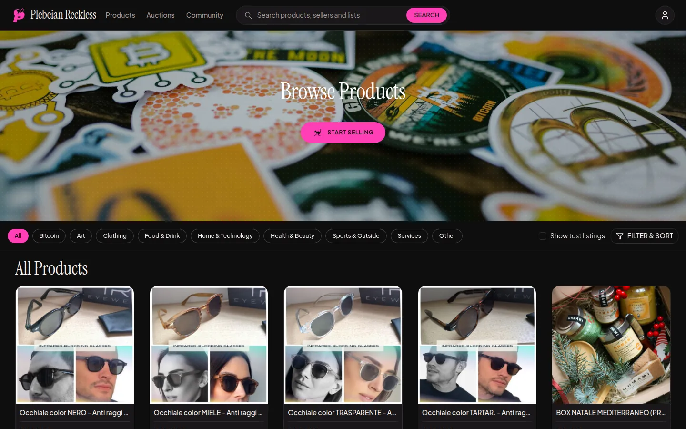
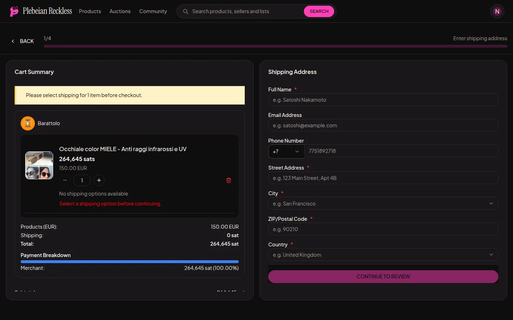

# Shopping

## Browse products

Open **Products** from the top bar. Use the category pills to filter, or **Filter & Sort** for more options.

## A product page

Each product page has a photo gallery, the price in sats (plus the seller's own currency), how many are in stock and who's selling it. Choose a quantity and click **Add to cart**. The heart, zap, message and share buttons sit under the seller's name.

## Your cart

Your cart slides in from the right. Items are grouped by seller, with a total in sats and a breakdown of who gets paid. Click **Checkout** when you're ready, or **Clear** to start over.

## Checkout

Checkout takes four short steps. First, check the cart summary and enter your shipping address. Then review the order and pay.

If a seller hasn't set up shipping yet, you'll see a note in red and won't be able to continue for that item. Messaging the seller is the quickest fix.

Your orders show up later under **Dashboard → Your Purchases**.

Next up: [Auctions](auctions.md).
