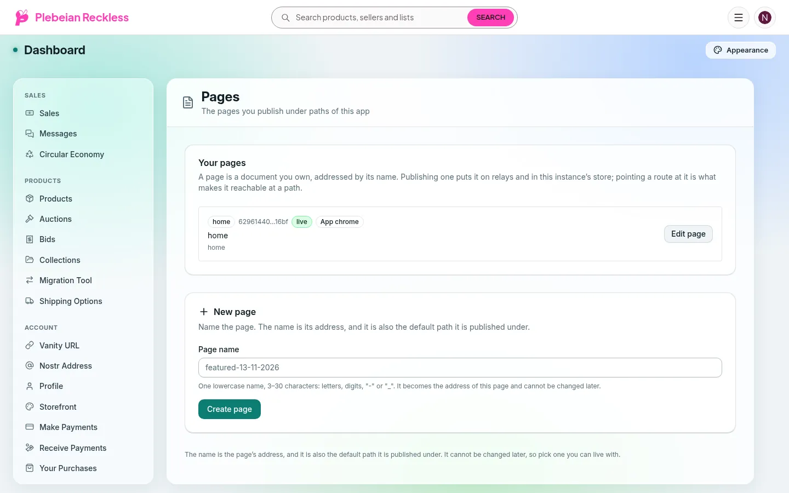
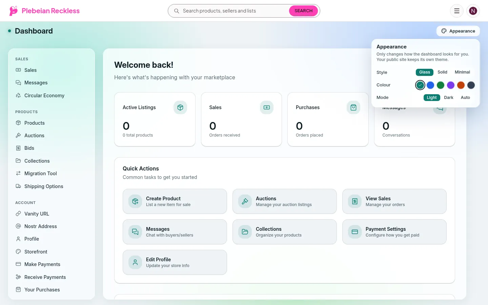

# Your storefront

## Pages

**Dashboard → Pages** is where you build pages for the site. Give a new page a name and click **Create page**. Then click **Edit page** to open the page editor, where you drag in blocks such as product rows, auction rows, text and images.

A page stays unlisted until you publish it and point a route at it.

## Home templates

Two home layouts ship with every instance. Open the home page in the editor, click **Change template** and pick one:

- **On the block.** The default home. A big headline over live lots, a tilted band, closing soon beside a pinboard of products, colour collection tiles and bento category sections.
- **Magazine cover.** A featured lot on the cover, auctions next, then products, collections and category shelves.

Applying a template gives you a normal page, so change anything you like before you publish.

### On the block

The blocks live under **Zine**:

- **Auction bento.** Your headline and intro over up to four lots. **Auto** puts the busiest live lots first. **Picked** shows the ones you choose, the first one big.
- **Closing soon + picks.** A numbered list of lots by end time, next to a pinboard of products.

A few blocks also have a **Style** option: the ticker can be a **Big band**, collections can be **Colour tiles**, and category sections can be a **Bento** with a badge on the big pick.

## The magazine home

The magazine cover has a featured live lot up top, auctions next, then products, collections and a few category shelves. Every part of it is a block, so you can change it all in the page editor.

To use it, open the home page in the editor, click **Change template** and pick **Magazine cover**. You'll find the blocks under **Magazine**:

- **Ticker strip.** A scrolling line of short messages. Turn on live stats to show lots live, the next lot to close and bids today.
- **Cover auction.** One lot, big, with a live countdown and the current bid. **Auto** picks the busiest live lot. **Picked** shows the one you choose.
- **Featured products spread.** One big product and two small ones, taken from your featured products.
- **Collections row.** Featured collections first, then the newest ones.
- **Category section.** A row of products for a list of tags, such as `hoodie, streetwear, clothing`.

The **Auction list** block also has new card styles (grid, closing soon or tall) and an order (ending soon, most bids or newest).

Tip: wrap a word in stars, like `Closing *soon*`, to set it in the accent colour.

## The dashboard look

The dashboard has its own theme, separate from the public site. Click **Appearance** at the top right to change it:

- **Style.** Glass, Solid or Minimal.
- **Colour.** Pick an accent colour. Teal is the default.
- **Mode.** Light, Dark or Auto, which follows your device.

These settings only change how the dashboard looks for you. Visitors always see the public site in the Arena theme.

## Coming soon

A Theme Studio for the public site is on the way. It will set one theme for the header, wallet and storefront together. You can follow along in [issue #27](https://github.com/PlebeianApp/PlebeianMarketV2Test/issues/27).

Back to the [guide index](README.md).
