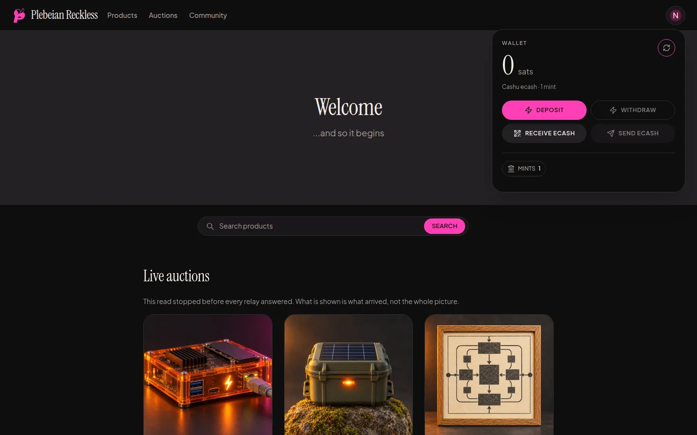
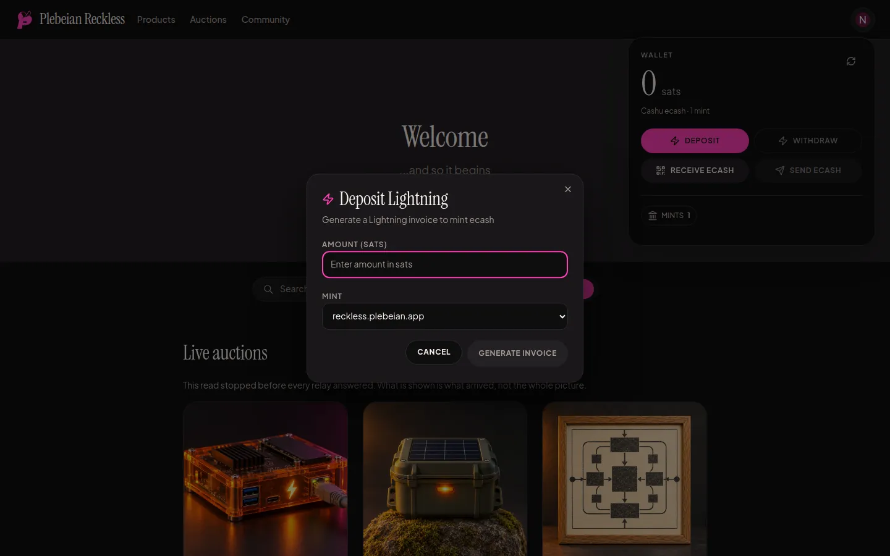

# Wallet

Your wallet holds Cashu ecash. It's built in and ties to your Nostr key, so it follows you to any device you sign in on.

## Opening the wallet

Open the account menu (your avatar, top right) and choose **Wallet**. The panel shows your balance in sats and how many mints you use.

## What the buttons do

| Button            | What it does                                                                          |
| ----------------- | ------------------------------------------------------------------------------------- |
| **Deposit**       | Creates a Lightning invoice. Pay it, and the mint gives you the same amount in ecash. |
| **Withdraw**      | Pays a Lightning invoice from your ecash.                                             |
| **Receive ecash** | Paste a Cashu token someone sent you to add it to your balance.                       |
| **Send ecash**    | Creates a Cashu token you can hand to someone.                                        |
| **Mints**         | Lists your mints and lets you add or remove one.                                      |

## Depositing

Click **Deposit**, enter an amount in sats, pick a mint and click **Generate invoice**. On Reckless the mint runs on test sats, so the invoice settles straight away and your balance goes up.

Next up: [Selling](selling.md).
